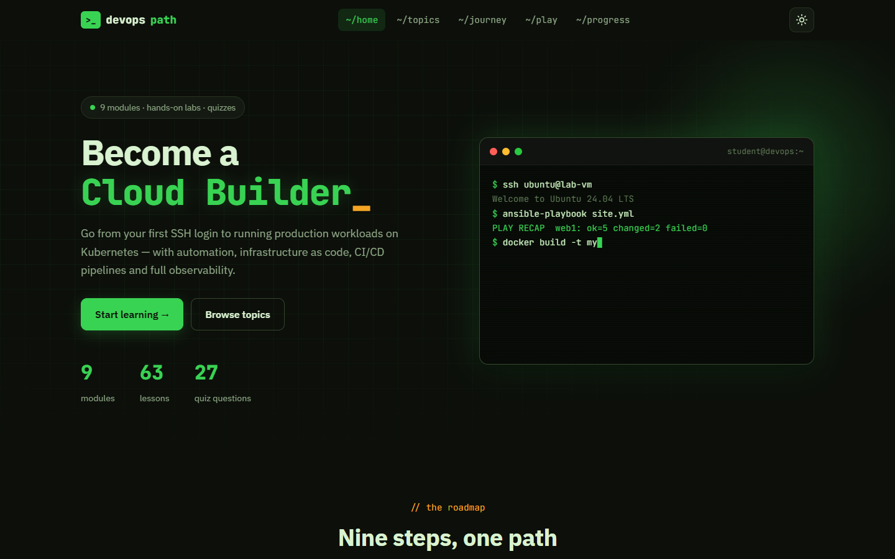
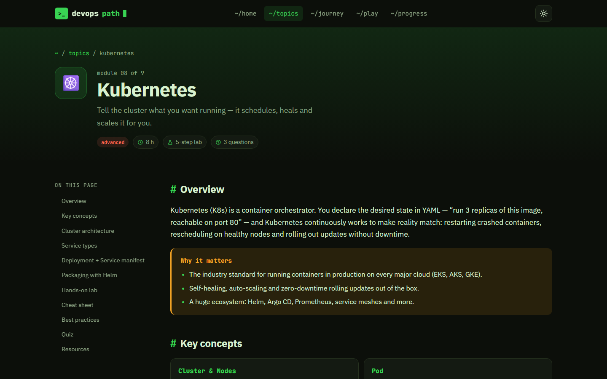
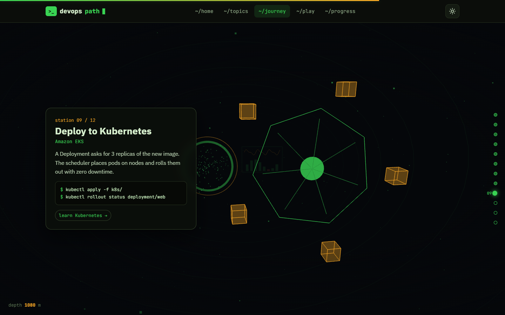
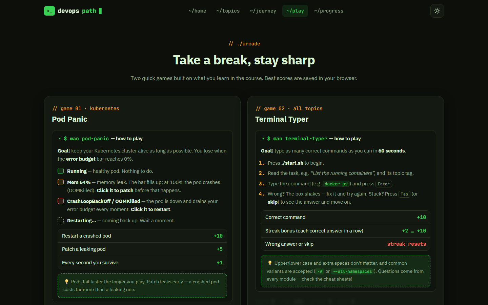

# 01 — Cloudflare Pages + Worker

**DevOpsPath** — a website for a DevOps course, deployed to Cloudflare Pages, with a JSON API running as a Cloudflare Worker.

| | Link |
|---|---|
| 🌐 Website (Cloudflare Pages, uploaded) | https://cf-pages-14y.pages.dev |
| 🔁 Website (Cloudflare Pages, auto-deployed from GitHub) | https://devops-homework.pages.dev |
| ⚙️ API (Cloudflare Worker) | https://devops-path-api.arshakpaskevichyan.workers.dev |



| Topic page | 3D journey | Arcade |
|---|---|---|
|  |  |  |

## Assignment

1. Build a nice-looking website for a DevOps course with HTML + CSS + JavaScript covering: Ansible, SSH, Virtualization & VirtualBox, Installing Docker, CI/CD, AWS, Kubernetes, Terraform, and Monitoring & Observability (Prometheus, Grafana, Loki, Alloy), with at least one JavaScript feature.
2. Deploy it with Cloudflare Pages and check the `*.pages.dev` link.
3. Create a Cloudflare Worker and check the `*.workers.dev` link.

## Features

- **9 topic pages** — overview, key concepts, deep-dive sections, hands-on lab with tickable steps, cheat sheet, best practices, quiz and links to official docs
- **Clean URL routing** (`/topics`, `/topic/docker`, `/progress`, …) with Back/Forward support and a terminal-style 404 page
- **3D journey** (`/journey`) — a scroll-driven [Three.js](https://threejs.org) dive through 12 stations, from `node server.js` on a laptop to live on the internet
- **Arcade** (`/play`) — *Pod Panic* (keep a Kubernetes cluster alive) and *Terminal Typer* (type real DevOps commands against the clock)
- Dark / light mode, search & level filters, progress tracking saved in the browser, copy buttons on code, quizzes with instant feedback
- "Terminal Green" colour palette, responsive down to phone width

## Project structure

```
01-cloudflare-pages/
├── public/              ← the website (HTML, CSS, JS, Three.js journey, games)
├── data/topics.js       ← all course content
├── server.js            ← Node.js + Express server for local development
├── scripts/build.js     ← builds dist/ — the static site uploaded to Pages
├── worker/src/handler.js← the Worker's source code
├── scripts/build-worker.js ← bundles code + content into worker/worker.js
├── worker/worker.js     ← the single file deployed to the Worker
└── docs/                ← screenshots
```

## Run locally

```bash
npm install
npm start            # http://localhost:3000
```

## Deploy

**Pages (automatic, from GitHub)** — every `git push` to `main` rebuilds https://devops-homework.pages.dev. Cloudflare Pages project settings:

| Setting | Value |
|---|---|
| Repository | `Arshak1988/devops-homework` |
| Production branch | `main` |
| Root directory | `01-cloudflare-pages` |
| Build command | `npm run build` |
| Build output directory | `dist` |

**Pages (manual upload)** — `npm run build`, then upload the `dist/` folder in *Workers & Pages → Create → Pages → Upload assets* (or `npm run deploy`).

> Upload `dist/`, not the project folder: the project folder contains `node_modules` (thousands of files, over the 1,000-file upload limit), and Pages can only host static files, not `server.js`.

**Worker** — `npm run build:worker`, then paste `worker/worker.js` into the Worker's *Edit code* editor and deploy (or `npm run deploy:worker`).

## Worker API

| Endpoint | Returns |
|---|---|
| `GET /` | Landing page listing the endpoints |
| `GET /api/topics` | All 9 topics (short) |
| `GET /api/topics/:slug` | One full topic, e.g. `/api/topics/kubernetes` |
| `GET /api/quiz/random` | A random quiz question (`?topic=docker` to filter) |
| `GET /api/health` | Status + which Cloudflare data centre answered |
