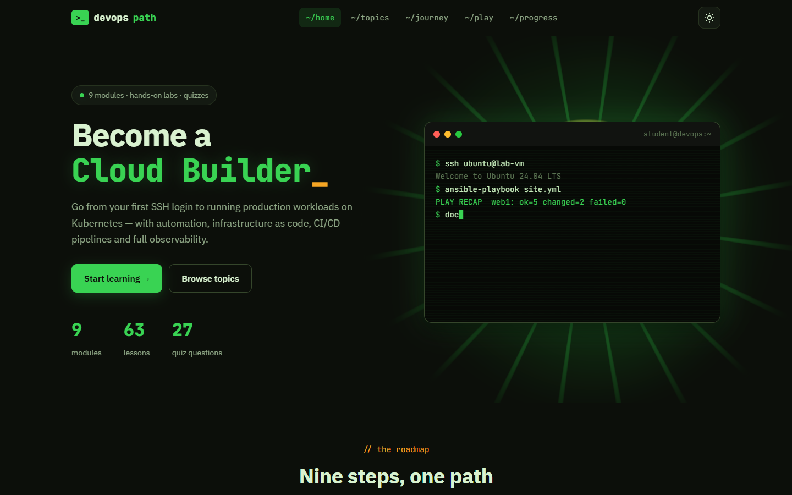

# DevOps Course - Homework

All my homework for the DevOps course, one folder per assignment.

| # | Homework | Live links | Folder |
|---|----------|-----------|--------|
| 01 | Cloudflare Pages + Worker - DevOps course website & API | [Pages site](https://cf-pages-14y.pages.dev) / [Worker API](https://devops-path-api.arshakpaskevichyan.workers.dev) | [`01-cloudflare-pages`](01-cloudflare-pages/) |
| 02 | Virtualization - Ubuntu 24.04 in VirtualBox | - | _coming next_ |

---

## Homework 01 - submission

| Item | Answer |
|---|---|
| **Pages link** | https://cf-pages-14y.pages.dev |
| **Pages link (auto-deployed from this GitHub repo)** | https://devops-homework.pages.dev |
| **Worker link** | https://devops-path-api.arshakpaskevichyan.workers.dev |
| **OS + CPU architecture** | **Windows, AMD64** (Windows 11 Home 64-bit, x64-based processor - Intel Core Ultra 7 155U) |
| **Source code** | [`01-cloudflare-pages/`](01-cloudflare-pages/) |

### Screenshot of the site



More screenshots: [topic page](01-cloudflare-pages/docs/screenshot-topic.png) / [3D journey](01-cloudflare-pages/docs/screenshot-journey.png) / [arcade](01-cloudflare-pages/docs/screenshot-play.png)

### Checklist

- [x] **1. Website** - HTML + CSS + JavaScript site for a DevOps course covering Ansible, SSH, Virtualization & VirtualBox, Installing Docker, CI/CD, AWS, Kubernetes, Terraform and Monitoring & Observability (Prometheus, Grafana, Loki, Alloy); JavaScript features include dark/light mode, expandable sections, routing, quizzes, a 3D journey and shader background built with Three.js WebGPU + TSL, and two games
- [x] **2. Cloudflare Pages** - deployed via *Workers & Pages -> Create -> Pages -> Upload assets*; `*.pages.dev` link checked
- [x] **3. Cloudflare Worker** - created via *Workers & Pages -> Create -> Worker*, code replaced with the DevOpsPath API; `*.workers.dev` link checked
- [x] **4. Ready for the virtualization lesson**
  - CPU architecture checked: **AMD64** (System type: *64-bit operating system, x64-based processor*)
  - Ubuntu ISO downloaded: `ubuntu-24.04.5.1-desktop-amd64.iso` - SHA-256 verified against the official `SHA256SUMS`
    (`4da4a0c9035da8e68a59a838674f403f0a54472c78a83b4fb7f78d03588f85a7`)
  - VirtualBox **7.2.22** installed (installer SHA-256 and Oracle digital signature verified)
  - WSL 2 installed, with Ubuntu running

---

## Environment

Windows 11 Home, AMD64 (Intel Core Ultra 7 155U, 15.5 GB RAM) / Node.js 24 / VirtualBox 7.2.22 / WSL 2 (Ubuntu)

## Repository layout

```
devops-homework/
|-- README.md                <- this file
|-- 01-cloudflare-pages/     <- homework 01
`-- 02-.../                  <- next homework
```
